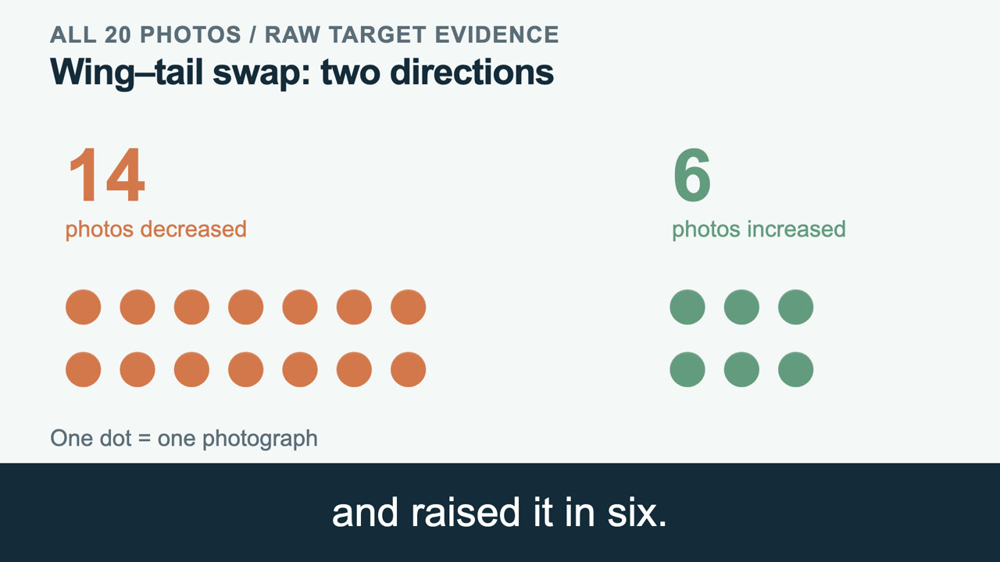

# Same Bird Parts, Different Evidence

A bird classifier kept calling one bird a glaucous-winged gull after we swapped its wing and tail. Its score for the gull rose from **19.41 to 23.97**, even as one of its strongest visual clues contributed almost nothing. We used a prototype-based CNN to see how the model could reach the same answer with different evidence.

[](https://yqia03.github.io/bird-parts-xai/)

**[Watch the presentation · 2 minutes](https://yqia03.github.io/bird-parts-xai/)** · [English captions](media/presentation.en.vtt) · [Video file](media/presentation.mp4)

## What changed across 20 photographs?

We ran one frozen **PIP-Net with a ConvNeXt-Tiny backbone** on 20 photographs from 10 bird species. We cut each bird into four parts and compared its original layout with two edits. Each swap kept the part pixels and added 24 pixels of separation. For every layout, we scored the same target species.

| Edit | Lower target score | Higher target score |
| --- | ---: | ---: |
| Swap head and tail | 20 of 20 | 0 of 20 |
| Swap wing and tail | 14 of 20 | 6 of 20 |

The gull above was one of the six increases. Prototype 158, a learned visual pattern, contributed **7.07** points before the wing–tail swap and **0.08** afterward. Other prototypes supplied enough evidence to raise the total. In the edited image, the wing moved 41 pixels right and 46 down, and the tail moved the same distances in the opposite direction. The review team checked the prototype values against the scoring export. These are raw model scores. Moving an intact bird also changed its score, so absolute position and visible seams matter when interpreting the swaps. [Gull case data](examples/gull.csv) · [Results for all 20 photos](analysis/score_changes.svg)

## Reproduce the analysis

From the repository root, run the following with Python 3.10 or later. It takes the 16 possible subsets of four parts in each layout, computes the exact second-order Shapley–Taylor interactions, and compares all 600 terms with the saved results.

```sh
python3 analysis/example.py
python3 -m unittest discover -s analysis/tests
```

[Analysis, data and figure](analysis/) · [Run the frozen model on an image](inference/) · [Video credits](media/CREDITS.md)

## Contributors

| Contributor | Work on the study |
| --- | --- |
| [WANG Shuangjing (@Bright430)](https://github.com/Bright430) | Ran the frozen model and exported target scores and prototype contributions. |
| [JIN Yupeng (@PP201666)](https://github.com/PP201666) | Prepared the bird-part masks, edited layouts and translation controls. |
| [QIAN Yuwei (@yqia03)](https://github.com/yqia03) | Integrated the image and score tables and led the AI-assisted interaction analysis. |
| [WANG Siming (@simon27493619-byte)](https://github.com/simon27493619-byte) | Reviewed the images and numerical claims and prepared the presentation materials. |

## Sources

The images came from [CUB-200-2011](https://www.vision.caltech.edu/datasets/cub_200_2011/). We used the [PIP-Net architecture](https://github.com/M-Nauta/PIPNet) and Romain Xu-Darme's [CaBRNet-trained CUB checkpoint](https://doi.org/10.5281/zenodo.18429182). The interaction analysis follows [Sundararajan, Dhamdhere and Agarwal (2020)](https://proceedings.mlr.press/v119/sundararajan20a.html).
