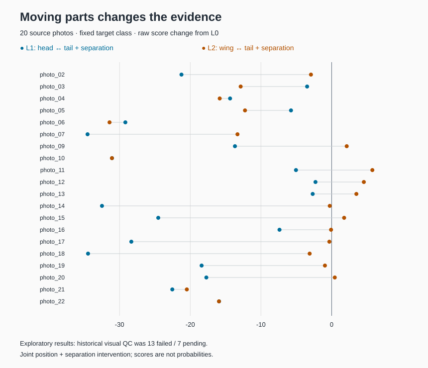

# Exact part interactions from saved model scores

This small, offline example recomputes second-order Shapley–Taylor (ST2) terms
from real saved scores in an exploratory bird-part intervention study. It includes
the project's original dependency-free implementation and its independent
exact-rational Möbius-oracle tests. Python 3.10+ is sufficient.

From the repository root:

```sh
python3 analysis/example.py
python3 -m unittest discover -s analysis/tests -v
```

The example prints the results and regenerates `results_summary.json` and
`score_changes.svg` in this directory. It reads only the three included CSV files;
it does not download data or run model inference.



## What changes when parts move?

The frozen model was the CaBRNet-trained PIPNet with a ConvNeXt Tiny backbone,
CUB-200, seed 0/final. Four manually defined players are **P1 head**, **P2 body
and legs**, **P3 visible wing**, and **P4 tail**. Their roles differ from the model's
learned prototype channels. For each source photograph, the target species stays
fixed across layouts and subsets.

- **L0:** original part positions.
- **L1:** head/tail position exchange plus fixed 24-pixel separation.
- **L2:** wing/tail position exchange plus fixed 24-pixel separation.

A coalition is a four-bit string in P1–P4 order. `0000` is the common background;
`1111` includes all four parts. The table has 20 photos × 3 layouts × 16 subsets
= 960 scalar target scores. The unit of observation is the source photograph,
so the sample size is **20**, rather than 960.

Compared with L0, all 20 L1 scores decrease (mean change **−18.2532**). L2 scores
decrease in 14 photos and increase in 6 (mean change **−7.1330**). These are raw
model evidence scores, not probabilities or accuracy changes.

For `photo_12`, the head–wing ST2 term changes from **+4.8844** in L0 to
**−1.6147** in L1 and **+0.5706** in L2. L2's full target evidence rises from
19.4104 to 23.9684 even though this particular pair term shrinks. A single
interaction term does not determine the full evidence score.

## Exact decomposition

For each of the 60 complete games, `scripts/st2.py` returns four singleton terms
and six pair terms. Singleton terms are `v({i}) − v(empty)`. Pair terms are
weighted second finite differences; effects of order three and four are shared
among their contained pairs. These are ST2 terms, not the Shapley interaction
index, and a pair term need not describe an isolated anatomical mechanism.

Every game satisfies:

```text
sum(singleton terms) + sum(pair terms) = v(1111) − v(0000)
```

The example matches all **600** originally exported terms with zero numerical
difference. The largest efficiency residual is **2.07 × 10⁻¹⁵**. The 15 tests
include known additive and higher-order games, 100 seeded random games checked
against an independent rational-arithmetic oracle, and real-data checks.

## Scope of the evidence

These are descriptive results from a small exploratory dataset. Historical
visual quality review recorded **13 failed and 7 pending** samples, with no
independent semantic review recorded in this analysis snapshot. All 20 were
retained in the delivered exploratory analysis; this example preserves those
flags. Moving parts and adding separation occur together, so these results do
not isolate structural causality. Cutting, background filling, and positional
effects remain possible explanations. The larger study also examined translation
controls; this small example does not reproduce that analysis.

Only the original scalar target-score exports are included here. The original
per-input 200-class score vectors were unavailable in this analysis snapshot;
this example does not independently verify class rankings or predictions.
Reproducing the numerical decomposition is distinct from reproducing inference
or validating the image construction.

## Files and provenance

| File | Contents |
| --- | --- |
| `data/coalition_scores.csv` | 960 scalar scores: anonymous photo, layout, four-bit coalition, target score |
| `data/expected_terms.csv` | 600 saved singleton/pair terms for comparison with recomputation |
| `data/photo_scores.csv` | 20 full-coalition score triples and historical visual-QC status |
| `scripts/st2.py` | Original exact four-player ST2 implementation |
| `tests/test_st2.py` | Original independent arithmetic and input-contract tests |
| `tests/test_saved_results.py` | Checks against the included research data |
| `provenance.json` | Input hashes and the extraction policy |

Data were extracted from the project's `c_final_v1` analysis snapshot, which
retained the numerical implementation of `c_analysis_delivery_v1` and the
`run_004_formal_A` inference export. Scalar strings are preserved verbatim. Photo
labels were replaced with anonymous photo IDs retaining the original project case numbers.
Only derived numerical tables, categorical QC flags and original analysis code
are redistributed here; the image dataset, masks, weights, course documents,
identities and original filesystem paths are omitted.

Method reference: Sundararajan, Dhamdhere and Agarwal,
[The Shapley Taylor Interaction Index](https://proceedings.mlr.press/v119/sundararajan20a.html),
ICML 2020.
